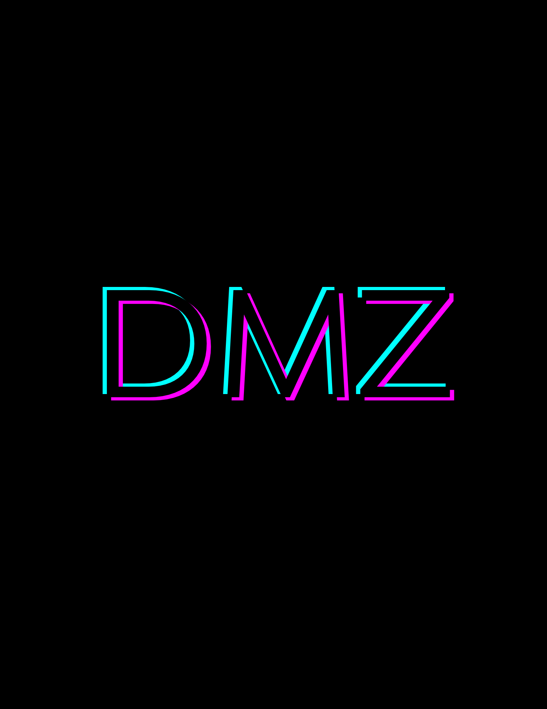

# DMC | DayZ Mod Creator

<p align="center"></p>

**Build, sign, deploy, and test DayZ mods with one keypress.**

DayZ Mod Creator (DMC) is a Windows desktop application that automates the repetitive steps between editing a DayZ mod and testing it in-game. Configure your local environment once, select a project, save your source files, and press **F5**.

DMC handles the build-and-test workflow. **You still write the mod and test its behavior in DayZ.**

## What DMC does

| Task you would normally do manually | How DMC helps |
| --- | --- |
| Find and reopen your mod projects | Remembers recent projects, detects addon folders containing `config.cpp`, and rejects unrelated directories |
| Configure tools and paths for every test | Detects DayZ Tools, the local server and client; saves shared and project-specific settings |
| Track required mods | Reads dependencies from mod configuration and lets you add local mods or Workshop IDs, including shared and server-side dependencies |
| Open AddonBuilder and package files | Builds one or more addons into `.pbo` files and retains build history |
| Sign each PBO manually | Optionally signs with your `.biprivatekey`, creates `.bisign` files, and verifies signatures |
| Copy the mod to the server and test client | Backs up previous local copies, deploys the build to both locations, installs public `.bikey` files as needed, and verifies copied files |
| Close the old test session | Stops recognized processes when it can safely identify them; otherwise asks for manual intervention |
| Start and configure the server | Launches the local DayZ server with the saved profile and dependencies, then checks mission startup and the game port |
| Start the game with the right mods | Launches the DayZ client with the test build and server address; looks for a connection confirmation in server logs |
| Rebuild everything after a partial failure | Can redeploy a verified build, relaunch an installed build, or resume eligible steps when sources and settings have not changed |
| Recover from a bad deployment | Creates local backups and supports rollback of affected mod files and keys |
| Read multiple logs to find a failure | Displays step-by-step progress, warnings, errors, logs, operation history, and actionable results |
| Upload an update to an existing Workshop item | Offers a **separate** Steam Workshop update action using a saved Workshop ID |

## The F5 workflow

```text
Edit and save your mod source files
                |
                v
        Press F5 in DMC
                |
                v
       Build addon PBO files
                |
                v
  Sign + verify (when enabled)
                |
                v
 Back up + deploy server/client copies
                |
                v
    Start local DayZ test server
                |
                v
  Wait for mission + port readiness
                |
                v
   Launch DayZ with the test mods
                |
                v
  Test your changes in the game
```

**F5 is for local testing only.** It does **not** publish anything to Steam Workshop.

## Getting started

1. Keep `dayz-mod-creator.exe` and `dayz-backend.exe` in the same directory. Launch the **frontend EXE**. If your current build still uses the old filename, launch `dayz-mod-studio.exe` instead.
2. Choose your mod project folder. DMC checks for a DayZ addon structure, including `config.cpp`.
3. Use the first-run setup to configure or confirm DayZ Tools, the local server, client, profiles, ports, dependencies, and optional signing keys.
4. Edit and save your mod files in your preferred editor.
5. Press **F5: Build & Test**. Follow the progress in DMC.
6. Once the server and game have launched, connect if needed and test your changes in DayZ.
7. Repeat steps 4–6 for the next iteration.

The one-time setup is required. DMC does not install DayZ, DayZ Tools, a test server, or missing third-party mods for you.

## Signing and security

- **Signing is optional**, but can be required by your server's configuration.
- When signing is enabled and configured, DMC signs new PBOs with your `.biprivatekey`, produces `.bisign` files, verifies the signatures, and installs the required public `.bikey` files on the local test server.
- When signing is disabled, DMC reports the stage as **Skipped**, not **Successful**.
- Private signing keys stay local and must **not** be uploaded or copied to the server.
- Deployment targets are separate local test locations. DMC protects Steam-managed Workshop download directories from direct writes.
- If DMC cannot safely identify a running DayZ client or test process, it stops before replacing files and asks you to close the process manually.

## Build once, resume when possible

You do not always need to rebuild. Depending on the previous result, DMC can install an already verified build, launch an installed build, or continue a failed test stage. If source files or build-relevant settings have changed, a new build is required.

## Steam Workshop updates

Local testing and Steam publication are intentionally separate.

| Action | Behavior |
| --- | --- |
| **F5: Build & Test** | Builds and deploys locally, then starts the test environment |
| **Update Workshop** | Uploads an existing mod update to the configured Steam Workshop item |
| **First Workshop publication** | Must be completed manually before DMC can update that item |

A valid Workshop ID and the appropriate Steam access are needed for Workshop updates.

## Desktop application

- **Platform:** Windows
- **Languages:** Ukrainian and English
- **Themes:** Dark and light
- **Settings:** Persist between launches
- **Portable distribution:** Two executables working together

| Executable | Role |
| --- | --- |
| `dayz-mod-creator.exe` (or legacy `dayz-mod-studio.exe`) | Desktop interface you launch |
| `dayz-backend.exe` | Bundled Python backend that carries out build, signing, deployment, and test operations |

The frontend launches the backend automatically. The portable build does not require users to install Python separately. DayZ and its required tooling are still needed to run the actual workflow.

## What DMC does not do

- It does not write or debug your mod code for you.
- It does not automatically confirm that gameplay features behave correctly.
- It does not publish to Workshop when you press F5.
- It does not silently overwrite Steam-managed Workshop downloads.
- It cannot always control an already-running game client, especially when process detection is restricted.

## Test status and limitations

The `MyMod` test has confirmed the following operations: PBO building, signature creation and validation, deployment to server and client copies, rollback, server readiness, and client launch.

**Not yet confirmed in that test:** successful player login detected from server logs. DMC therefore reported **Needs attention** instead of claiming that the entire end-to-end test succeeded.

This is a statement of the reported test scope, **not** a claim that every possible DayZ mod, server configuration, or Steam Workshop update has been validated.

## Why DMC exists

Without automation:

`Edit → Save → Open tools → Build PBO → Sign → Copy files → Update keys → Restart server → Start client → Test`

With DMC:

**`Edit → Save → F5 → Test`**

DMC is an independent community tool and is not an official Bohemia Interactive product.
